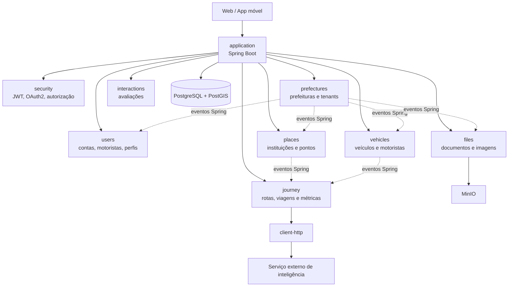

# Rota Fácil — Monólito multimodular

Backend do Rota Fácil, plataforma para gerenciamento de transporte escolar. O sistema atende prefeituras, administradores, motoristas, estudantes e gestores do produto, permitindo cadastrar a estrutura do transporte, planejar rotas, operar viagens e acompanhar documentos, arquivos e avaliações.

Este repositório representa a arquitetura nova do sistema. Ele substitui a antiga composição de microserviços — `auth-service`, `transport-service`, `places-service`, `file-service`, `notification-service`, `audit-service`, `gateway-service` e `eureka-service` — por uma aplicação Spring Boot organizada em módulos Maven por domínio.

## Sumário

- [Visão geral](#visão-geral)
- [Arquitetura](#arquitetura)
- [Módulos](#módulos)
- [Como o sistema funciona](#como-o-sistema-funciona)
- [Funcionalidades](#funcionalidades)
- [API HTTP](#api-http)
- [Segurança e autorização](#segurança-e-autorização)
- [Persistência e modelo de dados](#persistência-e-modelo-de-dados)
- [Arquivos e MinIO](#arquivos-e-minio)
- [Integração com inteligência](#integração-com-inteligência)
- [Execução local](#execução-local)
- [Estrutura de código](#estrutura-de-código)
- [Pontos de atenção](#pontos-de-atenção)

## Visão geral

O Rota Fácil gerencia o ciclo completo do transporte escolar:

1. O gestor cria e administra prefeituras.
2. A prefeitura cadastra instituições, pontos de embarque, veículos e motoristas.
3. Um administrador cria rotas com horários, dias da semana, instituições e pontos associados.
4. A associação de uma rota a veículos gera viagens recorrentes e, conforme o dia, viagens operacionais.
5. O motorista inicia, executa, finaliza ou cancela uma viagem.
6. Estudantes consultam viagens, fazem check-in/entrada e podem participar delas.
7. O sistema registra alunos, pontos e instituições visitados, localização, status, lotação e avaliações.

O isolamento entre prefeituras é realizado principalmente por `prefectureId` e pelas consultas que recebem a prefeitura do usuário autenticado.

## Arquitetura

### Estilo arquitetural

O projeto é um **monólito multimodular**:

- existe um único processo Spring Boot e um único contexto de aplicação;
- os domínios continuam separados em módulos Maven;
- os módulos compartilham a mesma JVM, banco e transação quando necessário;
- a comunicação interna é feita por injeção de dependência, chamadas diretas e eventos Spring;
- não há gateway, service discovery ou comunicação HTTP entre os módulos de domínio;
- a integração externa de inteligência continua sendo HTTP, por meio do `client-http`.



### Camadas dentro de cada domínio

Os módulos seguem uma organização consistente:

```text
<modulo>/src/main/java/com/rota/facil/<dominio>/
├── business/
│   ├── useCases/     # casos de uso, uma operação de negócio por classe
│   └── helpers/      # validações e operações reutilizáveis
├── domain/           # enums, objetos de dados e conceitos do domínio
├── http/
│   ├── controllers/  # entrada HTTP
│   ├── dto/          # requests e responses
│   └── exceptions/   # erros expostos pela API
├── persistence/
│   ├── entities/     # entidades JPA
│   ├── repositories/ # acesso ao banco
│   └── mappers/      # conversão entre persistência e API
└── spring/events/    # eventos e listeners entre módulos
```

A regra de negócio não fica concentrada em um `Service` gigante. Cada operação relevante possui um caso de uso próprio, normalmente composto por helpers, repositories, mappers e outros casos de uso.

## Módulos

| Módulo | Responsabilidade | Principais capacidades |
|---|---|---|
| `application` | Composição e inicialização | Classe `Application`, configuração OpenAPI, dependência dos demais módulos |
| `security` | Identidade e proteção da API | Login, cadastro, JWT, Google OAuth2, logout, desativação e filtros de autenticação |
| `users` | Usuários e perfis | Usuário atual, conta, troca de prefeitura, criação/listagem de motoristas |
| `prefectures` | Multi-tenant | Criar, listar, buscar, atualizar e desativar prefeituras |
| `places` | Estrutura geográfica da prefeitura | Instituições e pontos de embarque, coordenadas, ativação/desativação |
| `vehicles` | Frota | Veículos, capacidade, placa, tipo, status e motorista associado |
| `journey` | Operação do transporte | Rotas, viagens, recorrência, check-in, localização, status, lotação, métricas e mapa de calor |
| `interactions` | Avaliações | Feedback entre estudantes e motoristas |
| `files` | Arquivos | Fotos, documentos, CNH, comprovante de matrícula e mapas de calor |
| `notification` | Reservado para notificações | O módulo existe no reactor Maven, mas não possui código-fonte em `src/main` atualmente |
| `client-http` | Clientes externos | Cliente HTTP tipado para o serviço de inteligência |
| `annotations` | Infraestrutura compartilhada | Anotação `@UseCase`, usada para registrar casos de uso como componentes Spring |

### Dependências e composição

O `pom.xml` raiz é um `packaging=pom` e agrega todos os módulos. O módulo `application` depende dos módulos de domínio e fornece o artefato executável Spring Boot. Assim, a separação é de organização, compilação e responsabilidade — não de processos independentes.

## Como o sistema funciona

### Fluxo de uma requisição

```text
HTTP request
  ↓
SecurityFilterChain
  ↓
RotaFacilAuthenticationFilter
  ↓  (JWT validado e UserEntity carregado)
Controller
  ↓
UseCase
  ↓
Helpers + Repositories + outros domínios
  ↓
Mapper
  ↓
Response DTO
```

O usuário autenticado é recebido nos controllers com `@AuthenticationPrincipal UserEntity currentUser`. Os casos de uso usam essa identidade para validar papel, prefeitura e acesso ao recurso.

### Criação e operação de uma rota

Uma rota contém:

- nome e turno;
- horário de ida, fim da ida, volta e fim da volta;
- dias da semana;
- veículos recorrentes;
- instituições, cada uma com horário esperado de ida e retorno;
- pontos de embarque, cada um com horário de ida e retorno.

Ao criar a rota, `CreateRouteUseCase`:

1. converte o request em entidade;
2. associa a rota à prefeitura do usuário;
3. valida instituições e pontos existentes;
4. cria as entidades de associação com seus horários;
5. salva a rota;
6. cria as recorrências de veículos;
7. cria viagens para o dia atual quando o dia da rota é aplicável.

Na atualização, `UpdateRouteUseCase` compara as associações recebidas, remove as que não vieram, cria as novas e atualiza os horários das existentes. A atualização é bloqueada quando existem viagens iniciadas para a rota.

### Ciclo de uma viagem

Uma `TripEntity` representa uma execução de uma rota com um veículo. Ela mantém:

- status operacional (`Progress`);
- localização e ponto geográfico PostGIS;
- quantidade de estudantes;
- histórico de status e atrasos;
- instituições e pontos visitados;
- instituições e pontos ignorados;
- motivo de cancelamento;
- relacionamento com rota, veículo e prefeitura.

O fluxo operacional é dividido em casos de uso: criação, consulta do dia, consulta das próprias viagens, entrada do estudante, início, processamento, retorno, cancelamento, listagem de alunos e desativação.

## Funcionalidades

### Autenticação e contas

Endpoints públicos:

- `POST /auth/register`
- `POST /auth/login`
- `POST /auth/complete/google`

Endpoints autenticados:

- `DELETE /auth/logout`
- `DELETE /auth/deactivate`
- `GET /users/me`
- `PUT /users/update`

O login tradicional usa senha com BCrypt. O login Google possui um fluxo de conclusão com `pendingToken`. O JWT é enviado como `Authorization: Bearer <token>`.

### Prefeituras e multi-tenancy

O módulo `prefectures` fornece criação, consulta, listagem, atualização e desativação de prefeituras, além de região/estado e eventos para que os outros módulos reajam à desativação. A criação da prefeitura dispara a criação de um usuário administrador padrão por evento.

Rotas de prefeitura são públicas para leitura e protegidas por `SUPERUSER` para mutação.

### Instituições e pontos de embarque

O módulo `places` gerencia nome e coordenadas de instituições e pontos. Ambos possuem CRUD paginado, associação à prefeitura e validações para impedir remoções incompatíveis com viagens/rotas ativas.

Rotas principais:

- `/places/institutions`
- `/places/board-points`

As associações de rota guardam os horários esperados individualmente. Isso permite que duas instituições ou pontos da mesma rota tenham previsões diferentes.

### Veículos e motoristas

O módulo `vehicles` gerencia placa, capacidade, tipo, status operacional, motorista associado, troca de motorista e consulta do veículo de um motorista. Também há integração com `users` para criação e listagem de motoristas.

### Rotas e viagens

Rotas:

- `POST /routes`
- `GET /routes`
- `GET /routes/{routeId}`
- `PUT /routes/{routeId}`
- `DELETE /routes/{routeId}` — desativação lógica
- `POST /routes/heat-map/{routeId}`

Viagens:

- `POST /trips`
- `GET /trips/today`
- `GET /trips/my-today`
- `POST /trips/{tripId}/join`
- `POST /trips/{tripId}/checkin`
- `POST /trips/{tripId}/init`
- `POST /trips/{tripId}/return`
- `POST /trips/{tripId}/cancel`
- `GET /trips/{tripId}/students`
- `DELETE /trips/{tripId}` — desativação lógica

### Avaliações

O módulo `interactions` permite estudante ou motorista enviar feedback e administrador consultar feedbacks de um usuário. O domínio possui regras para impedir autoavaliação e avaliações entre papéis incompatíveis.

### Arquivos e documentos

O módulo `files` separa metadados do arquivo e armazenamento físico. A persistência registra categoria, usuário, prefeitura, tamanho, tipo MIME e chave do objeto; o conteúdo é enviado ao MinIO.

Categorias e fluxos existentes:

- foto de perfil do usuário;
- foto de perfil de motorista administrada por admin;
- CNH própria do motorista;
- CNH de motorista administrada por admin;
- comprovante de matrícula do estudante;
- avaliação de documentos por status;
- fotos de instituições, pontos e veículos;
- upload de mapa de calor de rota.

### Métricas e inteligência

`GET /journey/metrics` expõe métricas para administrador. Além das métricas convencionais, o produto possui funcionalidades de análise operacional e visualização geográfica implementadas no `intelligence-service`. Embora o processamento esteja em outro repositório/processo, essas capacidades fazem parte do Rota Fácil e só são acessadas pelos fluxos autorizados do Rota Fácil.

#### Mapa de calor das rotas

Fluxo público do produto:

```text
Front / app
  │ POST /routes/heat-map/{routeId}
  ▼
Rota Fácil — journey
  │ busca pontos de embarque escolhidos por estudantes
  │ envia POST /intelligence/route/heat-map
  ▼
intelligence-service
  │ constrói mapa de densidade com latitude/longitude
  │ gera PNG com Plotly/OpenStreetMap
  │ envia multipart para POST /files/heat-map/{routeId}
  ▼
Rota Fácil — files
  │ grava metadados e objeto no MinIO
  └─ disponibiliza o arquivo associado à rota
```

O endpoint do monólito é `POST /routes/heat-map/{routeId}`. O `GenerateHeatMapRouteUseCase` monta o contexto do usuário — ID, prefeitura, e-mail e papel — e coleta os pontos por meio de `TripUserRepository`. O cliente declarado em `client-http` chama `POST /intelligence/route/heat-map`.

O `intelligence-service` recebe:

- `currentUser`: identidade e prefeitura que originaram a solicitação;
- `routeId`: rota analisada;
- `points`: lista de latitude/longitude dos pontos selecionados pelos estudantes.

Internamente, o serviço usa Pandas para montar os dados, Plotly para gerar o mapa de densidade e faz uma chamada de retorno ao Rota Fácil. Essa chamada usa `multipart/form-data` para o PNG e o header `x-api-key` para autenticação entre serviços. O filtro `RotaFacilIntelligenceCommunicationFilter` reconhece essa comunicação no endpoint de upload do mapa.

#### Interpretação operacional de uma rota

O `intelligence-service` também expõe `POST /intelligence/route/interpretation`. Essa funcionalidade recebe o contexto operacional da rota:

- horários esperados de ida, fim da ida, volta e fim da volta;
- turno e dias recorrentes;
- histórico de viagens;
- instituições esperadas e efetivamente atendidas;
- status, atraso e momento dos eventos.

O serviço envia esses dados para um modelo da OpenAI (`gpt-4.1-nano`) com instruções para produzir uma interpretação curta e objetiva. A análise procura:

- percentual e frequência de atrasos;
- cancelamentos e pontualidade;
- tendências de melhora ou piora;
- padrões recorrentes;
- possíveis comportamentos futuros da rota;
- justificativas baseadas nos dados recebidos, sem inventar informações.

O resultado retorna no campo `routeInterpretation` e representa uma capacidade analítica do Rota Fácil, não uma funcionalidade genérica exposta diretamente aos usuários do serviço de inteligência.

#### Estado da integração

No código atual do monólito, o cliente `IntelligenceHttpClient` declara explicitamente o fluxo de mapa de calor. O controller do serviço de inteligência já possui o endpoint de interpretação, mas não há, neste monólito, um client HTTP/use case/controller correspondente para consumi-lo. A integração de interpretação deve ser considerada uma capacidade existente no ecossistema, porém ainda pendente de completar no backend monolítico caso o front precise acessá-la por este contrato.

O `client-http` usa `RestClient` e `HttpServiceProxyFactory`, com timeout de conexão de 10 segundos e leitura de 660 segundos. As URLs são configuradas por `INTELLIGENCE_BASE_URL`, e a autenticação de retorno usa `X_API_KEY_INTELLIGENCE`/`ROTA_FACIL_API_KEY`.

## API HTTP

| Área | Prefixo | Leitura | Escrita principal |
|---|---|---|---|
| Auth | `/auth` | — | registro, login, Google, logout |
| Prefeituras | `/prefectures` | pública | `SUPERUSER` |
| Instituições | `/places/institutions` | autenticada | `ADMIN` |
| Pontos | `/places/board-points` | autenticada | `ADMIN` |
| Rotas | `/routes` | autenticada | criação/alteração/exclusão por `ADMIN` |
| Viagens | `/trips` | autenticada | depende do papel e operação |
| Veículos | `/vehicles` | autenticada | criação/alteração/exclusão por `ADMIN` |
| Usuários | `/users` | autenticada | admin para motoristas; usuário para própria conta |
| Feedbacks | `/feedbacks` | admin para leitura | estudante/motorista para escrita |
| Documentos | `/documents` | conforme documento | estudante, motorista e admin |
| Arquivos | `/files` | autenticada | conforme recurso |
| Métricas | `/journey/metrics` | `ADMIN` |

A especificação OpenAPI é disponibilizada pelo Springdoc. Em ambiente local, os endereços esperados são:

- Swagger UI: `http://localhost:8080/swagger-ui/index.html`
- OpenAPI JSON: `http://localhost:8080/v3/api-docs`
- Health: `http://localhost:8080/actuator/health`

## Segurança e autorização

Os papéis usados pelo domínio são `SUPERUSER`, `ADMIN`, `DRIVER` e `STUDENT`.

O `SecurityConfiguration` desabilita CSRF para a API stateless, configura CORS para `web.base.url` e `app.base.url`, registra login OAuth2 Google, usa `SessionCreationPolicy.STATELESS`, instala o filtro JWT e aplica regras por método HTTP, caminho e papel.

O filtro JWT extrai o e-mail do token, carrega o usuário e coloca `UserEntity` no `SecurityContext`. Os casos de uso continuam responsáveis por validar escopo da prefeitura e regras do domínio.

## Persistência e modelo de dados

O sistema usa PostgreSQL com PostGIS:

- `spring.jpa.hibernate.ddl-auto=validate`: o Hibernate não cria nem altera o schema;
- Flyway executa as migrações em `application/src/main/resources/db.migration`;
- entidades JPA são separadas por módulo, mas compartilham o mesmo banco;
- viagens armazenam `geography(Point,4326)` para localização.

Principais grupos de tabelas:

- identidade: usuários, tokens e prefeituras;
- lugares: instituições, pontos e arquivos associados;
- frota: veículos e arquivos;
- planejamento: rotas, dias recorrentes e associações de rota;
- operação: viagens, status, usuários da viagem, visitas e itens ignorados;
- arquivos: metadados, validações e associações por recurso;
- interações: feedbacks.

As migrações começam na `V1.0.0` e evoluem o domínio até a `V1.3.0`, cobrindo as entidades principais, recorrência de rotas, operação de viagens, arquivos, desativação de prefeitura e status de usuários. Para alterar o banco, crie uma nova migration versionada; não altere migrations já aplicadas.

## Arquivos e MinIO

O `FileStorage` abstrai o armazenamento e `MinioFileStorage` implementa o acesso ao MinIO. A aplicação utiliza URL privada para comunicação servidor-servidor, URL pública configurável, bucket configurável e entidades específicas para arquivos de usuário, veículo, instituição, ponto e rota.

O `docker-compose.yaml` deste repositório sobe a infraestrutura local — PostgreSQL/PostGIS e MinIO — mas não sobe a aplicação Java.

## Configuração

As principais propriedades podem ser sobrescritas por variáveis de ambiente:

| Variável | Uso | Padrão de desenvolvimento |
|---|---|---|
| `ROTA_FACIL_DATASOURCE_URL` | JDBC do PostgreSQL | `jdbc:postgresql://localhost:5432/rota_facil_database` |
| `ROTA_FACIL_DATASOURCE_USERNAME` | usuário do banco | `rota_facil` |
| `ROTA_FACIL_DATASOURCE_PASSWORD` | senha do banco | `admin` |
| `MINIO_URL` | endpoint MinIO | `http://localhost:9000` |
| `MINIO_PUBLIC_URL` | endpoint público MinIO | valor de `MINIO_URL` |
| `MINIO_ROOT_USER` | usuário MinIO | `admin` |
| `MINIO_ROOT_PASSWORD` | senha MinIO | `admin123` |
| `MINIO_BUCKET_NAME` | bucket | `rota-facil` |
| `SECURITY_PUBLIC_KEY` | chave pública RSA do JWT | valor de desenvolvimento no properties |
| `SECURITY_PRIVATE_KEY` | chave privada RSA do JWT | valor de desenvolvimento no properties |
| `GOOGLE_CLIENT_ID` | OAuth2 Google | obrigatório para Google |
| `GOOGLE_CLIENT_SECRET` | OAuth2 Google | obrigatório para Google |
| `WEB_BASE_URL` | origem do front | `http://localhost:3001` |
| `APP_BASE_URL` | origem do app | `http://localhost:8099` |
| `INTELLIGENCE_BASE_URL` | serviço de inteligência | `http://localhost:8000/intelligence` |
| `X_API_KEY_INTELLIGENCE` | autenticação da integração | valor de desenvolvimento |

Em ambientes reais, chaves, senhas e API keys devem ser fornecidas pelo ambiente de execução ou por um secret manager. Os valores de fallback do arquivo de configuração são apenas para desenvolvimento e não devem ser reutilizados em produção.

## Execução local

### Pré-requisitos

- Java 21;
- Maven Wrapper (`./mvnw`);
- Docker e Docker Compose;
- PostgreSQL/PostGIS e MinIO, ou os containers deste projeto;
- credenciais Google apenas se o fluxo Google for utilizado;
- serviço de inteligência apenas para o mapa de calor.

### Subir infraestrutura

```bash
docker compose up -d
```

### Compilar todos os módulos

```bash
./mvnw clean package
```

### Executar a aplicação

```bash
./mvnw -pl application -am spring-boot:run
```

Alternativamente, execute a classe `com.rota.facil.Application` pela IDE.

### Verificar saúde

```bash
curl http://localhost:8080/actuator/health
```

## Estrutura de código

```text
.
├── pom.xml
├── application/       # bootstrap Spring Boot e configuração global
├── security/          # autenticação, JWT, OAuth2 e autorização
├── users/              # usuários, motoristas e dados da conta
├── prefectures/       # prefeituras e eventos de tenant
├── places/             # instituições e pontos de embarque
├── vehicles/           # frota e associação de motoristas
├── journey/            # rotas, viagens, recorrências e métricas
├── interactions/       # feedbacks
├── files/              # upload, validação e armazenamento de arquivos
├── notification/       # módulo reservado
├── client-http/        # clientes HTTP externos
├── annotations/        # anotações compartilhadas
├── docs/               # diagramas e documentação do projeto
└── Dockerfile
```

## Padrões de implementação

### Casos de uso + helpers

Casos de uso são componentes Spring identificados por `@UseCase`. Eles representam operações observáveis do negócio, como `CreateRouteUseCase`, `UpdateRouteUseCase`, `JoinInTripUseCase` ou `UploadCnhUseCase`.

Helpers encapsulam operações menores e reutilizáveis, por exemplo localizar recurso e lançar exceção específica, validar atualização de rota, calcular atraso, verificar intervalo de horário, processar chegada em ponto ou instituição e registrar itens ignorados.

### DTOs e mappers

Controllers recebem requests e devolvem responses. Entidades JPA não deveriam ser o contrato público da API. Mappers como `RouteMapper`, `TripMapper`, `UserMapper`, `InstitutionMapper` e `FileMapper` fazem a conversão.

### Eventos internos

Eventos Spring são usados para desacoplamento dentro do monólito. Exemplos: desativação de prefeitura notifica `users`, `places`, `vehicles` e `files`; exclusão de veículo é observada por `journey`; exclusão/desativação de instituição ou ponto é validada contra rotas e viagens; criação de prefeitura dispara a criação do administrador padrão.

Esses eventos são síncronos no processo atual, salvo mudança explícita de implementação.

## Pontos de atenção encontrados na análise

Esta seção descreve o estado observado no código, não necessariamente bugs já corrigidos.

1. **Módulo de notificações vazio:** `notification` está declarado no reactor e é dependência de `application`, mas não há implementação de notificações em `src/main` atualmente.
2. **Docker Compose apenas de infraestrutura:** a aplicação Java não possui serviço no `docker-compose.yaml`; é necessário executá-la pelo Maven/IDE ou criar uma imagem/serviço adicional.
3. **Contrato de atualização de rota:** `UpdateRouteRequest` marca instituições e pontos como `@NotNull`, mas o controller não usa `@Valid` e `UpdateRouteUseCase` trata `null` como lista vazia. Isso permite limpar associações, mas o contrato deve ser padronizado.
4. **Identificador das associações de rota:** os responses de rota atuais mapeiam o ID da entidade de associação (`InstitutionRouteEntity`/`BoardPointRouteEntity`), enquanto o request de atualização usa o ID da instituição/ponto. Clientes precisam resolver essa diferença ou o response deve expor explicitamente os dois IDs.
5. **Escopo de prefeitura deve ser revisado por endpoint:** a intenção do sistema é multi-tenant, mas a proteção depende de cada caso de uso e repository. Novos casos de uso devem sempre validar `prefectureId` do usuário autenticado.
6. **Chaves com fallback no properties:** há chaves RSA e credenciais de desenvolvimento como fallback. Elas devem ser substituídas por secrets externos e rotacionadas antes de qualquer ambiente público.
7. **Filtro de comunicação com inteligência:** o filtro usa o header `x-api-key` e deve tratar sua ausência com segurança antes de chamar `equals`; também é importante garantir que a leitura do body não interfira no processamento posterior da requisição. Além disso, o matcher atual está configurado para `/files/heat-map`, enquanto o controller recebe `/files/heat-map/{routeId}`.
8. **Contrato do mapa de calor:** o `intelligence-service` espera uma resposta JSON contendo `presignedUrl`, mas o `HeatMapRouteController` atual do monólito declara `ResponseEntity<Void>`. Esse contrato precisa ser alinhado para o fluxo retornar a URL gerada ao chamador.
9. **Cobertura automatizada:** a estrutura Maven prevê testes, mas a análise do código-fonte não encontrou uma suíte relevante de testes em `src/test`. O domínio de viagens, autorização e isolamento entre prefeituras deve receber prioridade de testes de integração.
10. **Processamento de recorrências e viagens:** criação e atualização de rotas têm regras dependentes do dia atual e do estado das viagens. Alterações nesse fluxo devem ser verificadas com cenários de rota ativa, viagem iniciada, veículo alterado e associação removida.

## Direção recomendada para a evolução

Para completar a migração com segurança:

1. estabilizar os contratos HTTP, principalmente IDs de associações e valores `null` versus listas vazias;
2. centralizar políticas de escopo por prefeitura em helpers/repositories reutilizáveis;
3. adicionar testes de integração para os fluxos de autenticação, rota, viagem e desativação;
4. concluir ou remover o módulo de notificações conforme o plano de produto;
5. separar secrets de desenvolvimento do código versionado;
6. documentar os eventos internos e as invariantes de cada agregado;
7. adicionar observabilidade de requisições, erros, jobs de recorrência e chamadas ao serviço de inteligência.

## Licença e documentação adicional

Os diagramas, documentos de projeto e artefatos complementares estão em `docs/`. Consulte também `AGENTS.md` para o contexto de domínio e as regras de organização do monólito.
